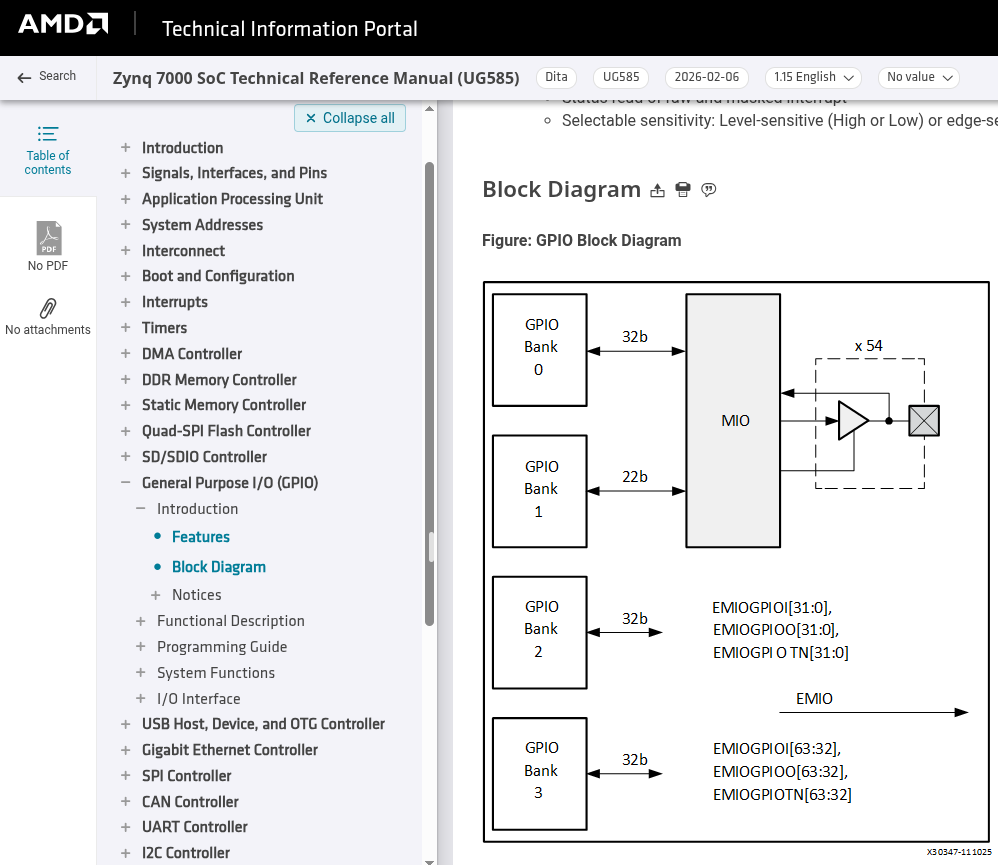

## TCL script for synthesizing a GPIO interface on the Zynq PL of the RedPitaya.

Tested with Vivado 2019.2 and Vivado 2024.1

To synthesize, execute ``sh ./launch.sh``. Make sure to ``export LANG="en_US.UTF-8"`` 
if working on a computer set to French.

Once synthesis is completed, convert the ``.bit`` file found in 
``./tmp/ex_axi_gpio/ex_axi_gpio.runs/impl_1/system_wrapper.bit`` to a ``.bit.bin`` using 
``bootgen`` by creating a ``bif`` file containing ``all:{system_wrapper.bit}`` and 
```sh
bootgen -image file.bif -arch zynq -process_bitstream bin
```
assuming the path includes the Vivado binaries. Transfer the resulting ``.bit.bin``
to the RedPitaya ``/lib/firmware`` directory, ``ssh`` to the RedPitaya and 
```sh
echo "system_wrapper.bit.bin" > /sys/class/fpga_manager/fpga0/firmware 
```
to configure the PL using FPGA Manager.

# Devicetree overlay

```
mkdir /sys/kernel/config/device-tree/overlays/myoverlay
cat devicetree_overlay.dtbo  > /sys/kernel/config/device-tree/overlays/myoverlay/dtbo 
ls -l /sys/class/gpio # lrwxrwxrwx    1 root     root             0 Jan  1 00:39 gpiochip630
```
and to access the various GPIOs
```
echo 631 > /sys/class/gpio/export
echo out > /sys/class/gpio/gpio631/direction
echo 1 > /sys/class/gpio/gpio631/value
```

630-512=118=32+22+32+32


